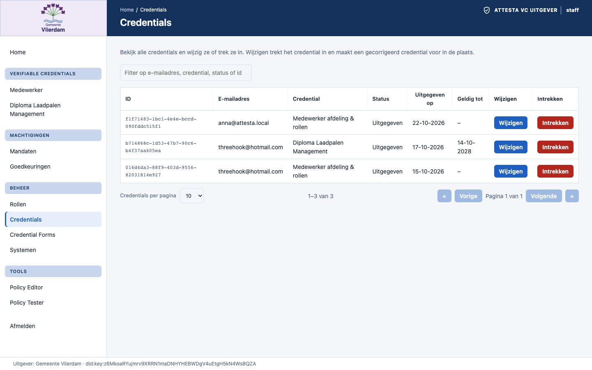

# Attesta

**Authorization where people and machines prove what they may do, and show nothing more than the question needs.**

An application asks Attesta whether something may happen. The wallet of the person answers with proof from an issuer you trust, only the facts that were
asked for, and a policy you wrote decides. No shared passwords, no copies of personal data in every application, and no guessing who is behind a request.

It works the same for the people in your organisation and for the pipelines, services and AI agents that act for them.

## What you get

- **Share less.** A request names the claims it needs, such as a department. The wallet shows those and nothing else. The person confirms in their own wallet, or
  chooses to always share with an application they trust.
- **Policies you can read.** Rules are written as code in Rego, changed without a restart, and tried out beforehand in the built-in Policy Editor and Policy
  Tester.
- **Unattended systems are covered.** A pipeline, a service or an AI agent gets an identity and a wallet of its own, and every action it takes asks first.
- **Take access back.** A revoked credential is denied. A mandate that was given to a system ends by itself, or earlier when someone ends it.
- **Every decision is recorded,** with its reason, so you can show who was allowed to do what, and why.
- **Easy to put in front of an application.** Attesta runs beside it as a sidecar; a Go library and a TypeScript client are included.
- **Your issuer, your trust.** Staff of your organisation issue the credentials: employees, roles, diplomas. Which issuers an application trusts is decided in
  its policy.

## Pipelines, services and AI agents

Nobody is at the screen when a nightly pipeline deploys, or when an AI agent decides to run a tool. In Attesta such a system is not a shared service account.
It has its own identity, which the platform it runs on vouches for, and its own wallet, whose key stays in a key vault.

People stay in control in advance. A release manager approves a **mandate**: *this pipeline may deploy production versions v1.4.\* until Friday.* It ends by
itself, and anyone with the right can revoke it earlier. For a one-off action that no mandate covers, the system parks the request and people approve that
single run. The example policy asks for two different people for production.

Every step the system takes, a deploy or a tool call of the agent, asks Attesta first and happens only when the answer is Permit. The repository includes
a CI/CD agent built on the Claude Agent SDK that works this way.

## How it works

1. **Issue.** Staff record in the issuer that a person is entitled to a credential. The person receives a QR code by mail and loads the credential into their wallet.
2. **Ask.** An application asks Attesta whether an action may happen. The wallet shows the requested claims, after the person confirms.
3. **Decide.** Attesta checks the credential and your policy decides. The application acts on Permit, and carries out the conditions that come with it.

## Built on open standards

| Standard | Used for |
|---|---|
| [OpenID for Verifiable Credential Issuance](https://openid.net/specs/openid-4-verifiable-credential-issuance-1_0.html) (OpenID4VCI) | the issuer gives a credential to a wallet |
| [OpenID for Verifiable Presentations](https://openid.net/specs/openid-4-verifiable-presentations-1_0.html) (OpenID4VP, DCQL) | the wallet shows a credential to Attesta |
| [SD-JWT VC](https://datatracker.ietf.org/doc/draft-ietf-oauth-sd-jwt-vc/) | the credential format; it discloses only selected claims |
| [Token Status List](https://datatracker.ietf.org/doc/draft-ietf-oauth-status-list/) | revoking credentials |
| [W3C DID](https://www.w3.org/TR/did-core/) (`did:key`) | the identity of an issuer |
| [Open Policy Agent](https://www.openpolicyagent.org/) and Rego | the policies |
| [SPIFFE](https://spiffe.io/) and SPIRE | the identity of a workload on Kubernetes |
| [OpenID Connect](https://openid.net/connect/) | staff signing in at the issuer (Keycloak, or your own server) |
| [Credo](https://github.com/openwallet-foundation/credo-ts) (OpenWallet Foundation) | the engine of the wallets |
| [OpenTelemetry](https://opentelemetry.io/) and the Logius [Authorization Decision Log](https://gitdocumentatie.logius.nl/publicatie/ftv/adl/1.0.0/) | the record of every decision |

## What is in the box

- **Attesta backend** (Go): verifies what a wallet shows and runs your policy.
- **Issuer** (Go and web pages): employee credentials, diplomas, roles, the systems that may get a credential, mandates, approvals, revoking and correcting.
- **Wallets:** a desktop wallet for people, and a headless wallet for systems that keeps its key in Azure Key Vault or OpenBao.
- **Libraries:** [enforcer-go](https://github.com/threehook/enforcer-go) for applications in Go, and a TypeScript client.
- **Examples:** a charging-station request app (`examples/laadpalen`) and the CI/CD agent (`examples/cicd-agent`).
- **Runs on Kubernetes,** locally and on Azure (AKS, set up with Terraform).

## More

- [Technical README](docs/development/README.md): how it is built and run. [Configuration](docs/configuration.md): every setting.
- [Architecture](docs/architecture/architecture.md) and [unattended authorization](docs/architecture/unattended-authorization.md).
- [Issuer](issuer/README.md), [laadpalen example](examples/laadpalen/README.md), [CI/CD agent example](examples/cicd-agent/README.md) and the
  [desktop wallet](wallet-desktop/README.md).

## License

MIT, see [LICENSE](LICENSE).
