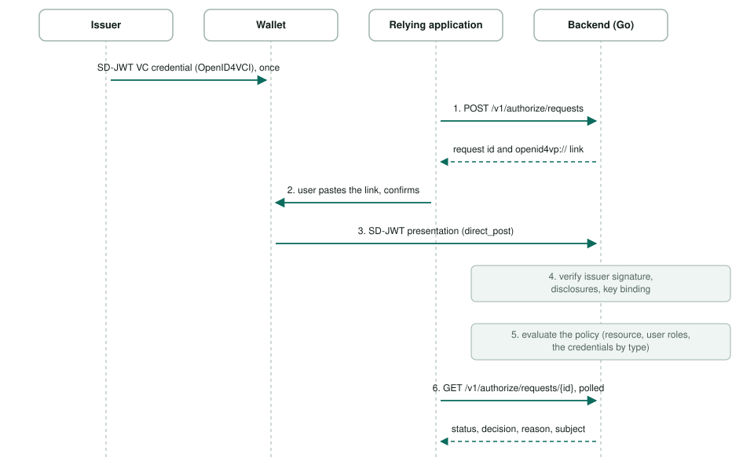

# Attesta architecture

This document describes how the pieces of Attesta fit together.

1. [How it works](#1-how-it-works)
2. [The scenario we design for: the workforce](#2-the-scenario-we-design-for-the-workforce)

## 1. How it works

This is the flow between a relying application, the shared backend and the desktop wallet. Around it:

- **The laadpalen example** (`examples/laadpalen`) puts an application backend between the page and Attesta, and runs Attesta as a **sidecar** in the application's pod.
  The page never talks to Attesta; the application asks Attesta whether an employee may do something, and then does the work itself.
- **Policies** are per application, and are reloaded while Attesta runs: they come from a directory (a ConfigMap in Kubernetes) that Attesta watches.
- **Claims** the employee discloses are passed to the policy, next to the resource and the user's roles, per credential type with its issuer.

## 2. The scenario we design for: the workforce

Attesta is designed for a **workforce** scenario. The people being authorized are the organisation's own employees. The organisation issues their credentials,
and the applications, the wallets and Attesta all run inside the organisation's network. There is no outside world to defend against. Because of that,
Attesta has one API and does not tell its callers apart; which workload may reach which is the platform's concern (network rules, service identity).

A **citizen or customer** scenario is different: the users are outside the organisation, choose their own wallet and bring credentials from third parties
(a national identity wallet, a bank). Attesta can act as a verifier for those wallets, but we do not build a wallet for them.
