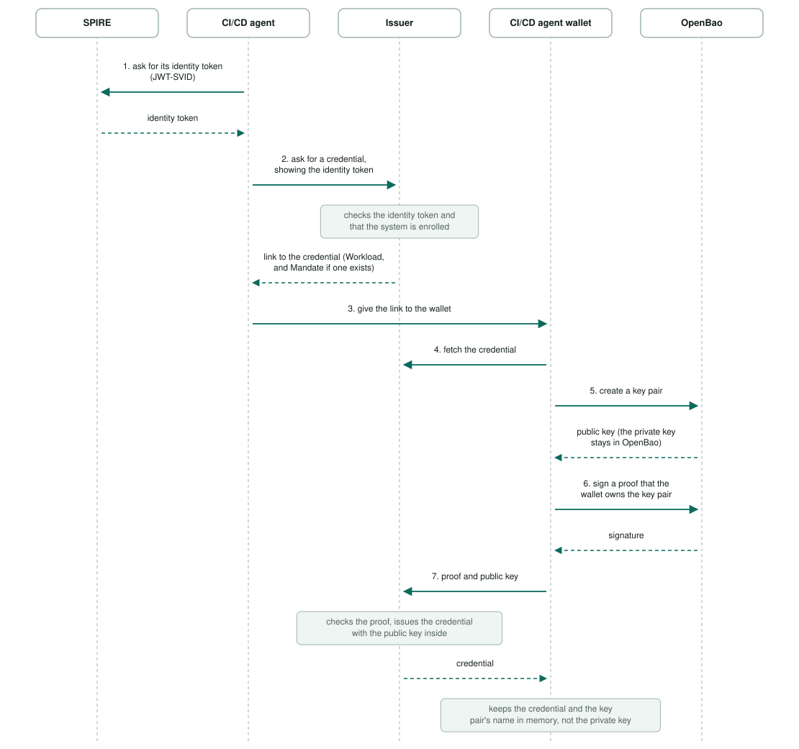
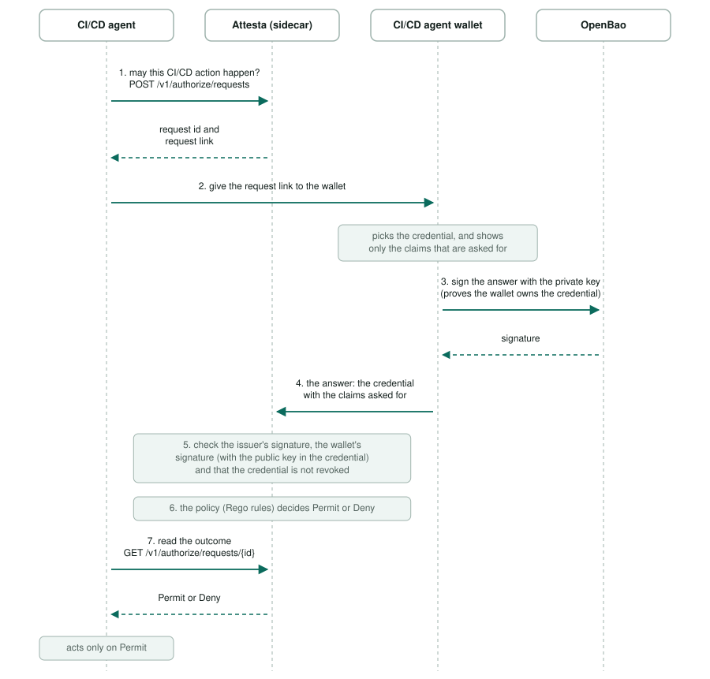

# The CI/CD agent: from pod start to a decision

This describes the **CI/CD case** on the **local Kubernetes deployment** (Docker Desktop, namespace `attesta`): the CI/CD agent example (`examples/cicd-agent/`),
an AI agent that builds and deploys software, and that has to be authorized before each tool it uses. Its wallet keeps its
keys in OpenBao, an open-source key store that runs in the cluster. In production we expect a cloud key store instead, such as Azure Key Vault or AWS KMS.
The flow stays the same; only the box "OpenBao" is replaced. The wallet needs one adapter for each kind of key store, and only the one for OpenBao exists.
It must be a store that signs for us, not one that only hands secrets out: a store that only hands secrets out would give the private key to the pod.

## Why

A credential is tied to a key pair, the **holder key**. The holder is the one the credential was issued to, here the wallet. The key pair has a **private key**,
which is secret and is used to sign, and a **public key**, which anyone may have and which checks the signatures. The issuer puts the public key in the
credential. Whoever can sign with the private key can use the credential. If the private key sits in the wallet's memory, anyone who gets into the
wallet can copy it and use the credential elsewhere. Here the private key is made and kept in OpenBao. The wallet asks OpenBao to sign and gets the signature
back, and OpenBao never gives out the private key.

This is for systems only, such as the CI/CD agent pod. A person's wallet runs on that person's computer and does not use OpenBao.

## Terms

- **Before the flow:** OpenBao is installed in the cluster and the wallet container has a token for it that can only make keys and sign (see `examples/cicd-agent/README.md`).
- **Pod, container:** the CI/CD agent, its wallet and Attesta run as three containers in one pod. The CI/CD agent container has no access to the wallet's keys.
- **Wallet:** the program that holds the CI/CD agent's credentials and answers requests for them.
- **Issuer:** gives the credentials (`Workload`, which says which system this is, and `Mandate`, which says what two people approved).
- **Credential:** a statement signed by the issuer. It contains the public key of the wallet it was given to.
- **Holder key:** the key pair a credential is tied to: the private key stays with the holder (the wallet), the public key is in the credential.
- **Attesta (sidecar):** receives the answer, checks it, and lets the policy (Rego rules) decide Permit or Deny.
- **Token:** a password that a program sends with each request, to show it may do this.
- **SPIRE, identity token (JWT-SVID):** SPIRE tells each pod, and anyone who asks, which system it is. The pod gets an identity token from SPIRE and shows it to the issuer.
- **Enrolled:** listed on the issuer's page Systemen as a system that may get a credential.
- **OpenBao, Transit:** OpenBao stores secrets; its Transit function makes key pairs and signs, and never gives out the private key.
- **Kubernetes Secret:** a stored password in the cluster that only the containers that ask for it receive.
- **Dev mode:** OpenBao started for testing, keeping everything in memory.

## 1. Getting the credentials (pod start, and again when a credential ends)

Steps 4 to 7 run for each credential, so each credential has its own key pair in OpenBao: two, for `Workload` and `Mandate`.

## 2. One authorization

Example: the CI/CD agent wants to run one of its tools, such as a deployment. It asks Attesta first and acts only on Permit.

OpenBao takes part only in steps 5 and 6 of section 1 and in step 3 here. Attesta checks the wallet's signature with the public key in the credential and has no
access to OpenBao.

## What this protects, and what it does not

- Someone in the CI/CD agent container gets nothing: it has neither the wallet's token nor the keys.
- Someone in the wallet container can use the token, so they can have OpenBao sign while they have access. They can also create and delete keys. They cannot take a private key away, because OpenBao has no call that returns one.

## Limits of the local setup

- OpenBao runs in dev mode and keeps keys in memory. After it restarts the keys are gone, the wallet's credentials point at keys that no longer exist, and every
  request is denied. OpenBao must be installed again (see `examples/cicd-agent/README.md`) and the pod restarted.
- The wallet keeps its credentials in memory, so a new pod gets new credentials and new keys. The old keys stay in OpenBao. Whether replacing a credential removes its old key has not been checked.
- The wallet reaches OpenBao over plain http inside the cluster.
- The wallet's token lasts 32 days and is not renewed.
