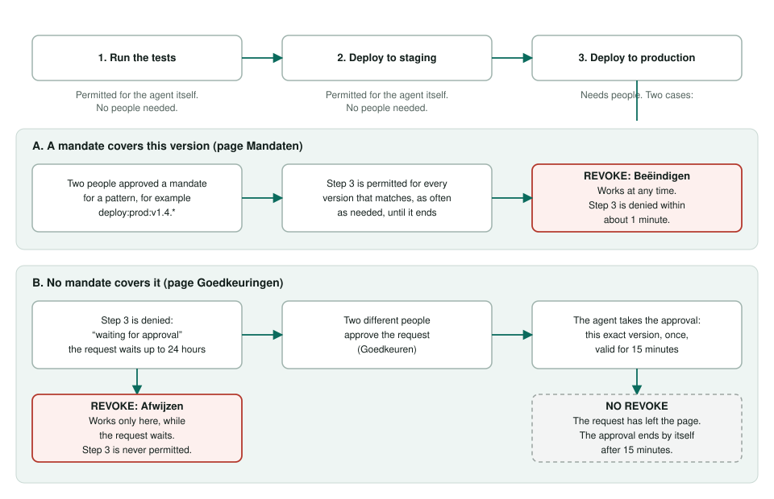
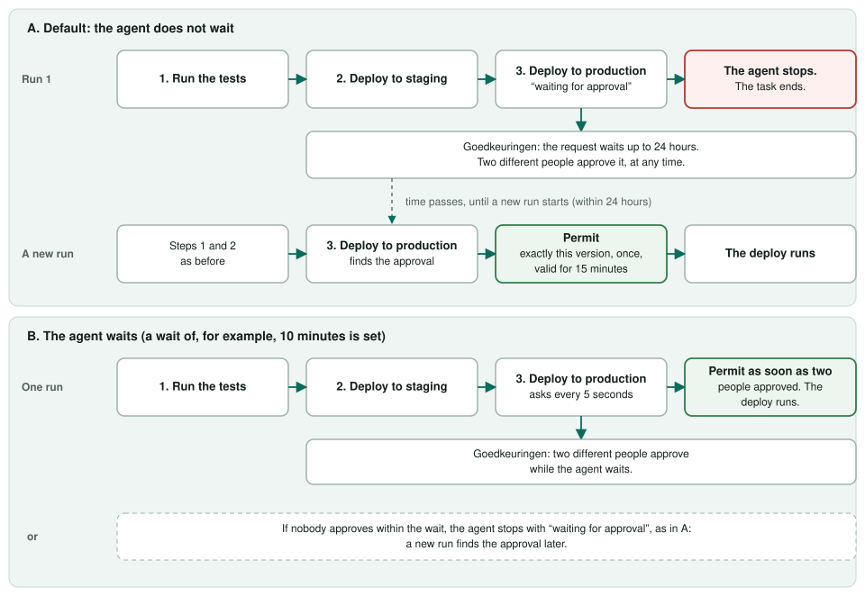

# Revoking in the CI/CD case

The CI/CD agent (`examples/cicd-agent/`) works on a task in steps and asks Attesta before each one. Revoking is how people take back what the agent was allowed to do.

## What the agent needs for each step

- **Run the tests and deploy to staging:** nothing from people. The policy permits them for the agent's own identity.
- **Deploy to production:** either a mandate that covers the version, or an approval for that exact version. Each needs two different people.

| | Mandate | Approval |
|---|---|---|
| Covers | a pattern, such as `deploy:prod:v1.4.*` | one version, such as `deploy:prod:v2.1.0` |
| Used | as often as needed, until it ends | once |
| Lasts | until its end date, or until it is ended | 15 minutes after the agent takes it |
| Created on | Mandaten | Goedkeuringen (the agent parks the action there when no mandate covers it; the request waits up to 24 hours) |

## When the agent finds the approval

By default the agent asks once, gets "waiting for approval" and stops: its instructions tell it to report the reason and stop when a tool is refused. Nothing checks in the background.
When two people have approved, a new run asks again, finds the approval and gets a Permit. That run must start within 24 hours, before the request expires.

With `CICD_APPROVAL_WAIT_SECONDS` set, the agent stays in step 3 for that many seconds and asks the issuer every 5 seconds. As soon as two people have approved, it continues in the same run.
If nobody approves within the wait, it stops as it does by default.

## Where to revoke

| To stop | Page | Button | Who |
|---|---|---|---|
| A person's credential | Credentials | Intrekken | issuer staff |
| A system | Systemen | Intrekken | issuer staff |
| A mandate | Mandaten | Beëindigen | `release-manager` |
| A request that waits for approval | Goedkeuringen | Afwijzen | `release-manager` |

- **A system:** its enrolment ends, so it cannot fetch new credentials, and all its credentials are revoked, `Workload` and `Mandate`. Its mandate is ended too, so enrolling it again needs a new approval from two people.
- **A mandate:** the mandate ends and the `Mandate` credentials made from it are revoked.
- **A request:** it can no longer be approved. It cannot be rejected once the agent has taken the approval: that approval ends after 15 minutes.

## How fast

Attesta reads the issuer's status list about once a minute, so a revoked credential can still get a Permit for up to a minute. A step that is already running is not interrupted.
