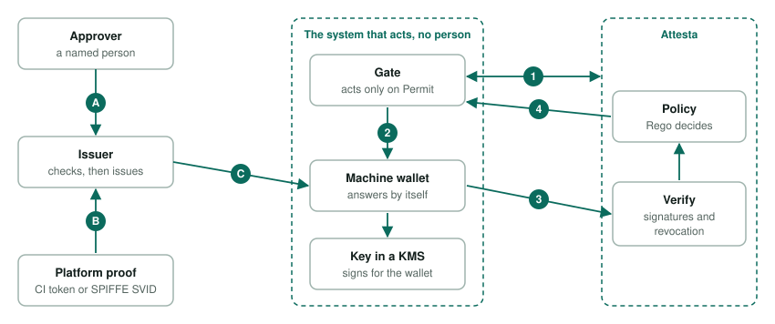

# Unattended authorization

Attesta asks a person to confirm in their wallet at the moment of a request. A nightly pipeline, an AI agent or a service has no person at that moment.
This document describes how such systems are authorized: the system gets its own wallet. A person decides in advance, once, what the system may do. When
the system acts, its wallet answers Attesta by itself, and the policy decides as usual.

1. [Terms](#1-terms)
2. [How it works](#2-how-it-works)
3. [An example, start to finish](#3-an-example-start-to-finish)
4. [Cases](#4-cases)
5. [Decisions](#5-decisions)
6. [Build in phases](#6-build-in-phases)
7. [Verified facts and open points](#7-verified-facts-and-open-points)

## 1. Terms

| Term | Meaning |
|---|---|
| **Attesta** | The backend that verifies what a wallet shows and lets the Rego policy decide. |
| **Issuer** | Gives out credentials. It checks first, then signs. |
| **Machine wallet** | A wallet that runs inside a system and answers by itself. It holds credentials and uses a key that is kept in a KMS, a key service that signs but never hands out the key. |
| **Gate** | A small piece in the system that acts. It asks Attesta whether the action may happen and does it only on Permit. Built on `enforcer-go`, or on the HTTP API from other languages. |
| **Identity credential** | Says what the system is: pipeline, repository, environment, owner team. |
| **Mandate** | A credential that says a named person allows one specific thing until a given time. Revocable through the status list. |

## 2. How it works

Getting credentials (letters):

- **A.** Once: a named person approves a mandate in their own wallet. The issuer checks their role first.
- **B.** Each run: the platform proves which system this is. A CI platform signs a token with repository, ref and environment. A Kubernetes workload gets a
  JWT-SVID from SPIFFE/SPIRE.
- **C.** The issuer checks the proof and issues the identity credential, plus the mandates, to the machine wallet. The workload shows its proof to the issuer's
  `POST /workloads/offer`, which answers with a credential offer link that works for five minutes; the machine wallet takes the credential from that link, as
  any wallet does. The credential lasts an hour unless `ATTESTA_ISSUER_WORKLOAD_LIFETIME` says otherwise.

Acting (numbers):

1. The gate asks Attesta whether this action may happen. Attesta returns a request link.
2. The gate hands the link to the machine wallet, a local call in the same job or pod.
3. The wallet signs with its KMS key and presents the identity credential and the mandates. Attesta verifies them.
4. The policy decides. The gate reads Permit or Deny and acts only on Permit.

This is the standard issuing and presenting flow (OpenID4VCI and OpenID4VP). The holder is a machine that answers by itself. The trigger does not matter,
because the gate always runs. A service does not have to know what called it.

### What a machine wallet holds

| Credential | What it says | How it is obtained | Lifetime |
|---|---|---|---|
| **Identity** | What the system is: workload id, owner (a person or team), environment, platform claims such as repository and ref | The issuer checks a platform proof and issues a credential bound to the wallet's key | Minutes to days, renewed automatically |
| **Mandate** | Named people's approval: what, where, until when. The scope is exact or a glob over the resource | People with the role `release-manager` approve on the issuer's page. The issuer issues it with the identity credential | As short as the policy requires. Revocable |

Routine work needs only the identity credential and the policy. Work that needs an accountable person adds a mandate. Two people agreeing means two
names in the `approvers` of one mandate; a request takes one credential per type, so the policy counts the names.

### SPIFFE/SPIRE

A Kubernetes workload proves what it is with SPIFFE/SPIRE. The issuer accepts a JWT-SVID, checked against the SPIFFE trust bundle, in the same way as a CI
platform's token. An SVID is an identity and not a credential from our issuer: it carries no roles, owner or mandate, and its key rotates about every hour.
So the machine wallet, the credentials and the policy stay as they are. The SVID also authorizes the workload to use its wallet key in the KMS.

## 3. An example, start to finish

A pipeline `shop-api` deploys a tagged release to production at night.

Tuesday 14:00, with a person:

1. Once per pipeline, issuer staff enroll `shop-api`: repository, environment, owner team and the public key of its machine wallet. The private key stays in
   the KMS.
2. Anna, the release manager, approves in her wallet: "`shop-api` may deploy tag `v1.4.2` to production until Friday."
3. The issuer checks that Anna holds the role `release-manager` and issues the mandate to the pipeline's machine wallet.

Wednesday 03:00, nobody there:

1. A tag push starts the pipeline. The job gets an identity credential from the issuer, using the platform's proof (B and C).
2. The deploy step runs the gate. The gate asks Attesta and hands the link to the machine wallet (1 and 2).
3. The wallet presents the identity credential and Anna's mandate (3).
4. The policy checks repository, ref, environment, owner, and that the mandate covers `v1.4.2` and has not expired. It answers Permit and the deploy runs (4).

Without Anna's approval there is no mandate, and the policy answers Deny with the reason.

## 4. Cases

| Case | What happens |
|---|---|
| Push, tag or merge starts a pipeline | The example above. |
| A user clicks a link on a page we do not own | The click only starts the pipeline. The gate and the machine wallet decide, as at night. |
| An AI agent | The agent's harness owns the machine wallet. Every tool call passes the gate. The agent has only our own tools, no shell. The key and the mandate stay out of the model's reach. |
| A service called by another service | Each service has its own machine wallet and shows its own identity. If a person stands behind the call, their mandate is shown too. |
| A server, kiosk or IoT device | Its wallet keeps the key in a TPM or secure element. The issuer issues after the device proves what it is. |
| A person with a CLI or mobile app | They use their own wallet. |
| Two people must agree | Two mandates from two people, held by the same machine wallet. One policy rule counts them. |
| A system is compromised or retired | The issuer revokes its credential. Short lifetimes limit the time before the revocation shows. |
| No mandate, or no proof of what the system is | Deny with the reason. |

## 5. Decisions

- **First system:** a Python service in Kubernetes that uses the Claude Agent SDK, with identity from SPIFFE/SPIRE. A GitHub Actions pipeline follows the
  same design. Other platforms are added to the issuer's list of accepted proofs.
- **Agent host:** the Agent SDK in the pod. Managed Agents with self-hosted sandboxes is an alternative: Claude runs at Anthropic and our worker in the pod
  executes custom tools. The gate sits where a tool executes, so the host can be exchanged.
- **Proof of what runs:** a CI token (repository, ref, environment) or a JWT-SVID. The issuer accepts proofs only from a configured list of platforms.
- **Keys:** one machine wallet per pipeline, with its key in a KMS. The runner may use the key only when the platform proof shows it is that pipeline. A
  mandate approved earlier needs this stable key, because a key made fresh at run time did not exist yet. Without a KMS, a system gets identity only, with a
  key made at start, and no mandates. The holder's key binding accepts EdDSA and ES256.
- **Identity claim:** a request names the claim that identifies the holder (`identityClaim`), `workload` for a system. Without it the claim is `email`, so
  applications that ask for people do not change. A SPIFFE ID is compared exactly, an email address without regard to case.
- **Enrollment:** staff enroll a workload by SPIFFE ID, owner and environment (`POST /workloads`, `GET /workloads`, `DELETE /workloads/{id}`, all behind the
  staff sign-in). Revoking an enrollment also revokes the credentials already made for it. The workload endpoint is not exposed outside the cluster.
- **Owner:** every identity credential names an owner team. Issuer staff, who have the role `issuer-staff`, can revoke it.
- **Mandates:** required for production deployments. Everything else is decided by policy on the identity alone. A mandate is a stored approval, and it becomes a credential each
  time the workload asks for its credentials, so it is bound to the key the wallet has then and needs no stable key. A system has one mandate at a time.
- **State:** Attesta keeps none. Credentials expire. Use-once is added only when a case needs it.
- **Missing mandate:** Deny with the reason. When people can undo the denial, the policy adds the advice `request_approval` and the gate parks the action (phase 4).
- **Parked approvals:** the gate asks the issuer (`POST /workloads/approvals`), which mails the approvers a link to the page Goedkeuringen. When two different people approved, the workload takes an
  `Approval` credential once: the exact resource, 15 minutes. The gate then asks again with the Approval in place of the Mandate. `CICD_APPROVAL_WAIT_SECONDS` is how long the gate waits for
  the people (0: it answers Pending at once, and the next ask picks the approval up). Attesta keeps no state: the credential is short, and the issuer hands it out once.
- **Unattended wallet:** it presents only to verifiers on a registered list. There is no switch to present to everyone, as in the desktop wallet.

## 6. Build in phases

Each phase ends with a review of the open points in section 7.

| Phase | Content | Done when |
|---|---|---|
| **0 Prove it** | A headless wallet presents with nobody there; the gate hands a link to the local wallet; the Python gate and the Agent SDK wiring work. | Verified, see section 7. |
| **1 Machine identity** | Issuer: a workload credential, an endpoint that checks the JWT-SVID or CI token and returns a short-lived credential offer, enrollment of a workload, owner claim. A generic holder identifier next to `email` in the backend, the entitlements and the credential forms. Wallet: unattended mode for registered verifiers. Gate as a Python module, a CLI and a GitHub Action. SPIRE in `k8s/local`. | A pipeline or pod gets Permit or Deny from policy with nobody present. |
| **2 Mandates** | The mandate credential and a page where named people approve it, for one exact item or by a glob. Revocable. | A production release needs two named people and still runs at night. |
| **3 Agents and services** | The gate as an agent hook and as service middleware. Key custody outside the model. The concrete action goes into the policy input (`action` in the request, `input.action` in the policy, `action_details` in the decision log). | An agent works a night shift inside its mandate and is stopped outside it. |
| **4 Parked approvals** | An uncovered action waits. The approvers get an https link, approve, and the issuer issues a one-time Approval. The system continues. | An unforeseen action waits for the morning and then proceeds. |
| **5 Devices and hosted wallet** | Devices prove what they are (TPM, secure element). The hosted wallet from [architecture.md](architecture.md) serves people away from their desktop. | A device and a phone both work. |
| **6 Enrolment page** | An issuer page where staff add a system (SPIFFE ID, owner, environment), see the enrolled systems and revoke one. It calls the staff API that exists (`POST`, `GET` and `DELETE /workloads`). | A customer enrols a system without database access. |

## 7. Verified facts and open points

| Point | Status | What the design does |
|---|---|---|
| A wallet kept in memory, with no files, took an Employee credential from the issuer and answered a request from a real backend, with nobody confirming | Tested locally | The wallet of a system (`wallet/src/serve-cli.ts`) does this in a pod. |
| In a cluster with SPIRE, the agent's pod showed its JWT-SVID to the issuer, its wallet took the credential and presented it unattended. Staging got Permit and production got Deny | Tested in the local cluster | The example in `examples/cicd-agent`. |
| A credential that is revoked is replaced once by a new one; a workload whose enrollment is revoked gets no new credential and is denied | Tested in the local cluster | The gate renews once when Attesta did not accept the credential. |
| A Python process handed the request link to the wallet through a local HTTP call. Staging got Permit and production got Deny | Tested locally | The gate uses this call. |
| The Agent SDK (0.2.170) has `can_use_tool`, `PreToolUse` hooks, in-process tool servers and an option to switch off the built-in tools | Checked in the SDK | A run against a live model is not done. |
| `spiffe` (0.3.2) fetches JWT-SVIDs with `fetch_jwt_svid(audience, …)` | Tested in the local cluster | The agent fetches one for each new credential. |
| The issuer's token endpoint accepts only the pre-authorized code. An entitlement belonged to an email address, and every credential form has an `email` field | Checked in code | An entitlement now belongs to a person or to a workload. A workload gets its offer from `POST /workloads/offer`, so the token endpoint and every wallet stay as they are. |
| Every request identified the holder by the `email` claim | Built and tested | A request can name another claim (`identityClaim`); the owner is a separate claim of the Workload credential. |
| One request needs one holder. A machine that holds its identity and several mandates is one holder | Checked in code | Mandates are issued to the machine wallet's key. |
| The verifier accepts EdDSA and ES256 for key binding | Checked in code | A KMS key with ES256 works without a library change. |
| A presentation lives as long as its request (5 minutes by default, configurable) | Checked in code | The machine presents live, so this is enough. |
| A mandate rule must be data. A signer must not be able to supply Rego code | Built and tested | The rule is a glob that the policy matches against the resource; the policy also requires that it names production. |
| A person could approve a mandate they do not understand | Built | The page shows the system, the resource and the end before the person approves. |
| An agent must not reach its own key or approve its own mandate | Built and tested | The wallet is a separate container that only the harness calls. The model has our two tools and a hook refuses any other; approving a mandate needs a person's sign-in at the issuer. |
| The issuer has to verify a JWT-SVID against a SPIFFE trust bundle | Tested in the local cluster | The issuer reads the bundle from the SPIFFE Workload API. A CI proof goes on the same list when a pipeline is the first system. |
| Delay between a revocation and the moment the status list shows it | Covered | Short lifetimes. An unreadable list already means Deny. |
| Offline devices cannot reach Attesta or the status list | Not checked | Phase 5. |
