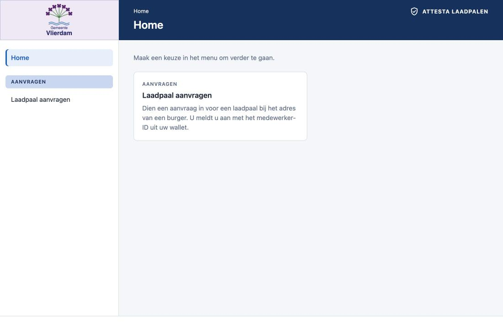
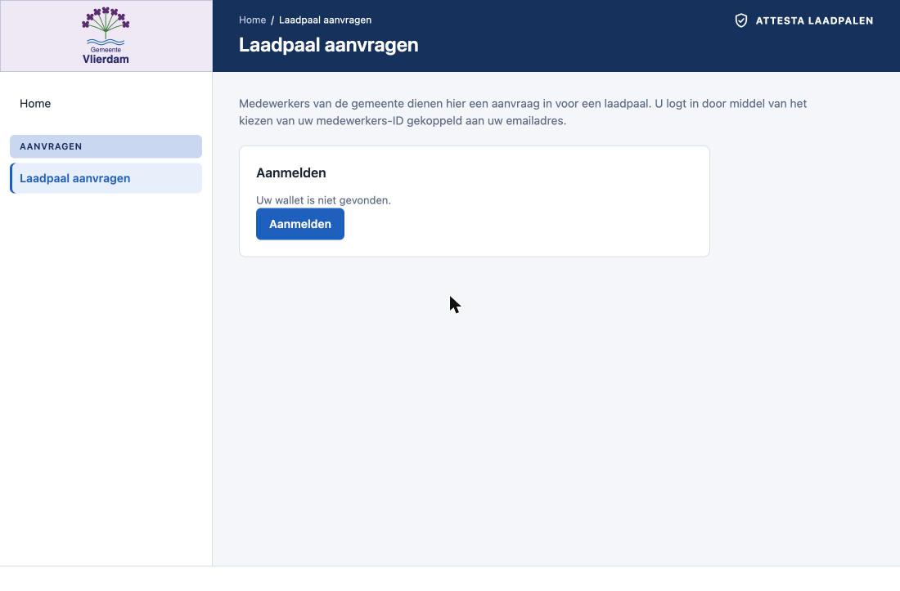

# laadpalen

A relying application with Attesta as its **sidecar**. Municipality employees submit requests for a laadpaal (EV charging point) for a citizen's address.
Who may submit is Attesta's decision, made from a credential in the employee's own wallet; what becomes of the request is the application's own business.

## What's here

- `api/` is the application's backend (Go, standard library only). The page calls it and nothing else. It asks the sidecar next to it who the employee
  is (sign-in) and whether they may submit, and then applies its own address rules (unknown address, a laadpaal already there, no electric vehicle).
  It records every decided request with the employee's `subject` (issuer and email).
- `gui/` is the page (Vite + React), in Dutch. The employee signs in, enters an address and sees the outcome; the page hands each step to the wallet itself.
- `policies/sign_in.rego` signs in an `Employee` credential from a trusted issuer; nothing but the identity is read.
- `policies/request_laadpaal.rego` decides a request on two credentials of the same person, both from a trusted issuer: an `Employee` for the `burgerzaken`
  department with the role `laadpalen-aanvrager` in its `roles`, and the diploma `Diploma Laadpalen Management` (a credential type of its own). Secretariaat employees are refused.
  Each credential's own expiry (a diploma's last day) is checked before the policy runs, so an expired diploma never gets here.

The page's home, and the sign-in on "Laadpaal aanvragen" (the wallet must be running to offer the employee's identities):





## How it fits together

```
browser ──► page (nginx) ──► laadpalen-api ──► Attesta (sidecar, 127.0.0.1:8080)      one pod: laadpalen-api
                                                    ▲
wallet ─────────────────────────────────────────────┘ :8080 (wallets reach it at `ATTESTA_PUBLIC_URL`)
```

1. **Sign in.** The page asks the wallet on this machine for the user's identities (email and issuer DID) and shows them in a dropdown;
   `GET /api/config` gives the origin the wallet knows this app by. "Aanmelden" posts to `POST /api/sign-in`. The backend asks Attesta for a request
   (`sign_in` for both `policyId` and `resource`, credential `Employee`, no claims beyond the email every request asks) and returns the `openid4vp://`
   link. The page adds the chosen identity to it (`login_hint`, `issuer_hint`) and opens it, so the system starts the wallet. The wallet's popup names the
   identity and offers to sign in without the button next time; if the user chose that, the page signs in by itself when it is opened.
2. The page polls `GET /api/sign-in/{id}`. An authorized outcome starts a **session**: the status response sets an HttpOnly cookie, and for 30 minutes
   (from the sign-in, not extended by use) the employee is signed in. The page shows who (`GET /api/session`) and has "Afmelden" (`DELETE /api/session`).
   Sessions live in memory, so a restart signs everyone out.
3. **Request a laadpaal.** Only in a session: the page posts the address to `POST /api/request-laadpaal`, which answers 401 without one. The backend asks
   Attesta for a request (`request_laadpaal`, credential `Employee` with the claims `department` and `roles`, and credential `Diploma Laadpalen Management`) and returns a link. The wallet asks what to
   share, or answers on its own when the user chose to always share with this application.
4. The page polls `GET /api/request-laadpaal/{id}`. When Attesta has decided, an authorized submission is carried out once: the address rules run and the
   outcome is recorded. The credential shown must be the signed-in employee's, otherwise the request is refused.

This is a workforce setup: the employees, their wallets, the application and Attesta all belong to one organisation and run inside its network. Attesta
has a single API and does not tell callers apart; which workloads may reach which is the platform's concern (network rules, service identity). The Service
`laadpalen-attesta` is a LoadBalancer only because the demo wallet runs on the host; a wallet inside the cluster would use the internal address.

## Running it

Docker Desktop's Kubernetes, with the shared namespace. The issuer must be deployed, since it signs the credentials and its DID is the one the policy trusts:

```sh
make k8s-issuer-apply     # the issuer
make laadpalen            # builds and deploys the backend with its sidecar, and the page: http://localhost:4174, or the Ingress address
pnpm --filter @attesta/wallet-desktop package    # the wallet: open the app once; it needs https, see CLAUDE.md for the names
```

Get the credentials: open the issuer's pages, sign in as `staff`, and record an `Employee` (department Burgerzaken or Secretariaat, roles chosen from the list) and
the diploma Laadpalen Management (a date in the future) for the same email address; upload each QR code from the mail in the wallet. Then open the laadpalen page, sign in and enter an address (1111BB 2 is free, 1111AA 1 has a laadpaal, 1111DD 4 has no
electric vehicle). Press "Aanmelden", then "Dien aanvraag in". The page opens the wallet each time; the link is also under "Toon API-aanroep" for a wallet
that has to be given it by hand.

The wallet reaches Attesta at the address in `ATTESTA_PUBLIC_URL` in `k8s/local/laadpalen/api/deployment.yaml` (the `laadpalen-attesta` Service, container port 8080, is also on http://localhost:4175 for a development wallet).

## Roles

The roles are in the employee's `Employee` credential (chosen from the list on the issuer's form); the policy reads them from there. An employee whose roles do not
include `laadpalen-aanvrager` is refused with "Niet geautoriseerd vanwege rol". The sign-in asks for the Employee's identity and nothing else.

The demo employees (record an `Employee` and the diploma for each on the issuer's pages):

| Employee | Email | Department | Roles | Diploma Laadpalen Management | Outcome |
|---|---|---|---|---|---|
| Jerry Smith | jsmith@vlierdam.nl | Burgerzaken | `laadpalen-aanvrager` | yes | allowed |
| Tom de Vries | tdvries@vlierdam.nl | Burgerzaken | none | yes | refused, "Niet geautoriseerd vanwege rol" |
| Sanne Bakker | sbakker@vlierdam.nl | Secretariaat | none | yes | refused, "Niet geautoriseerd vanwege afdeling" |
| Piet Jansen | pjansen@vlierdam.nl | Burgerzaken | `laadpalen-aanvrager` | no | the wallet holds no diploma, so it cannot answer |

## Policies

`make laadpalen-policies` writes `policies/*.rego` into the ConfigMap `laadpalen-policies`. The sidecar watches it, so a changed policy is live within about a
minute, with no restart. The application owns this ConfigMap: the file set is the whole set.

## Tests and logs

```sh
cd examples/laadpalen/api && go test ./...         # the backend against a fake sidecar, and the sidecar client
make laadpalen-logs laadpalen-attesta-logs         # the backend's log (who submitted what) and the sidecar's
make laadpalen-delete
```

`backend/internal/authz/examples_test.go` runs the policies through the real OPA engine. To change a policy, open it in the issuer's Policy Editor (Tools) and try it in the Policy Tester; a policy reads `input.credentials["Employee"]` and `input.credentials["Diploma Laadpalen Management"]`, each with `issuer` and `claims`.
